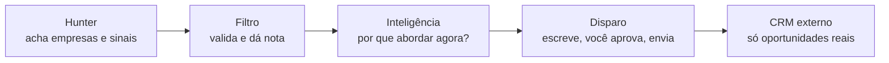

# Prospector B2B

Plataforma que **encontra empresas, confere os dados, descobre por que abordá-las agora e envia mensagens com aprovação humana**. Primeiro cliente: Agência VIA.

> **Status:** planejamento validado — nenhum código escrito ainda. Veja [docs/PROGRESSO.md](docs/PROGRESSO.md).

## Por onde começar (leigo)
1. Leia [docs/COMO_USAR.md](docs/COMO_USAR.md) (5 min).
2. Veja o mapa das etapas abaixo e abra a etapa atual em `docs/etapas/`.
3. Cada etapa diz: o que será feito, o que você precisa decidir e **como conferir se deu certo**.

## Mapa

## Etapas
| # | Etapa | Resultado em linguagem simples |
|---|---|---|
| 0 | [Fundação](docs/etapas/sprint-00-fundacao.md) | Sistema abre no navegador, com login e cadastros |
| 1 | [Hunter: caixas de email](docs/etapas/sprint-01-caixas-email.md) | Lê seus emails e lista quem você já conhece |
| 2a | [Hunter: empresas](docs/etapas/sprint-02a-empresas.md) | Lista empresas do seu público-alvo |
| 2b | [Hunter: sinais](docs/etapas/sprint-02b-sinais.md) | Descobre vagas, notícias, expansões |
| 3 | [Sem duplicados](docs/etapas/sprint-03-duplicados.md) | Uma empresa = um registro |
| 4 | [Validar emails](docs/etapas/sprint-04-validar-emails.md) | Sabe se o email existe, sem enviar nada |
| 5a | [Enriquecer e notas](docs/etapas/sprint-05a-enriquecimento.md) | Nome, cargo e 4 notas por contato |
| 5b | [Inteligência comercial](docs/etapas/sprint-05b-inteligencia.md) | Hipótese: "por que abordar" |
| 6a | [Envio seguro: cadastro](docs/etapas/sprint-06a-envio-cadastro.md) | Caixas e domínios + trava de segurança |
| 6b | [Envio seguro: agenda](docs/etapas/sprint-06b-envio-agenda.md) | Limites, bounces e disjuntor |
| 7 | [Mensagens e aprovação](docs/etapas/sprint-07-mensagens.md) | IA escreve, você aprova em lote |
| 8 | [Sequências, respostas, CRM](docs/etapas/sprint-08-respostas-crm.md) | Resposta vira oportunidade no CRM |
| 9 | [Métricas](docs/etapas/sprint-09-metricas.md) | Sabe o que funciona |
| 10 | [Produção](docs/etapas/sprint-10-producao.md) | Roda em servidor real |

Documentos de apoio: [Validação do plano](docs/VALIDACAO_DO_PLANO.md) · [Ferramentas por etapa](docs/FERRAMENTAS.md) · [Glossário](docs/GLOSSARIO.md) · [Prompt mestre original](docs/PROMPT_MESTRE.md)
